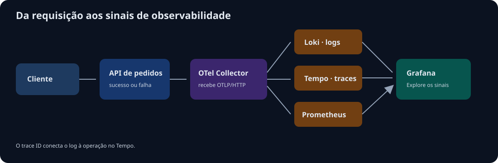

# LGTM Observability Lab

Uma API de pedidos demonstrativa envia logs, métricas e traces correlacionados para uma stack local com Grafana, Loki, Tempo e Prometheus. Explore o comportamento de requisições bem-sucedidas e falhas pelo Grafana.



## Executar

Requisitos: Docker e Docker Compose, com memória e espaço disponíveis para a imagem Grafana LGTM.

```sh
docker compose up -d
curl http://localhost:8088/health
curl http://localhost:8088/order
curl 'http://localhost:8088/order?fail=true'
```

`/health` responde `200`. `/order` retorna `200` e um `trace_id`; `?fail=true` simula uma falha e retorna `500` com seu `trace_id`. As requisições geram um log, um span e atualizam o contador. Aguarde a inicialização da stack antes de enviar requisições.

Abra [Grafana](http://localhost:3300) com `admin` / `admin`. No **Explore**:

| Sinal | Datasource | Consulta ou ação |
|---|---|---|
| Logs | Loki | `{service_name="lgtm-demo"}` |
| Traces | Tempo | Busque pelo `trace_id` retornado pela API. |
| Métricas | Prometheus | `demo_orders_total` |

O log inclui o mesmo trace ID do span, permitindo seguir a operação entre Loki e Tempo. Para acompanhar a aplicação, execute `docker compose logs -f app`.

## Fluxo

1. O cliente faz uma requisição à API local de demonstração.
2. A API envia os três sinais via OTLP/HTTP ao OpenTelemetry Collector.
3. O Collector encaminha logs ao Loki, traces ao Tempo e métricas ao Prometheus.
4. O Grafana consulta os três backends para exploração.

O `M` usa Prometheus neste laboratório. A imagem oficial `grafana/otel-lgtm` reúne os componentes em um container para simplificar a execução local.

## Validação local

Com Docker Compose, `/order` retornou `200` e `?fail=true` retornou `500`. O Loki apresentou o log de erro com o mesmo trace ID retornado pela API; o Tempo retornou o span com status de erro e o Prometheus apresentou o contador `demo_orders_total`. Para reproduzir, faça as requisições acima e consulte os três sinais no Grafana.

## Segurança e limitações

- O lab é local e não foi preparado para produção: usa HTTP e credenciais Grafana de demonstração.
- As portas publicadas ficam restritas a `127.0.0.1`.
- A API usa uma implementação mínima de OTLP em Python para tornar os dados visíveis; não representa a instrumentação recomendada para aplicações de produção, onde um SDK OpenTelemetry é mais apropriado.
- A exportação é síncrona e a API retorna `503` se o collector estiver indisponível.
- A tag `latest` da imagem pode mudar; fixe uma versão para resultados reproduzíveis.
- `docker compose down` encerra o lab e preserva o volume; `docker compose down -v` também apaga os dados.

Referências: [Grafana Docker OpenTelemetry LGTM](https://grafana.com/docs/opentelemetry/docker-lgtm/) e [projeto da imagem](https://github.com/grafana/docker-otel-lgtm).
